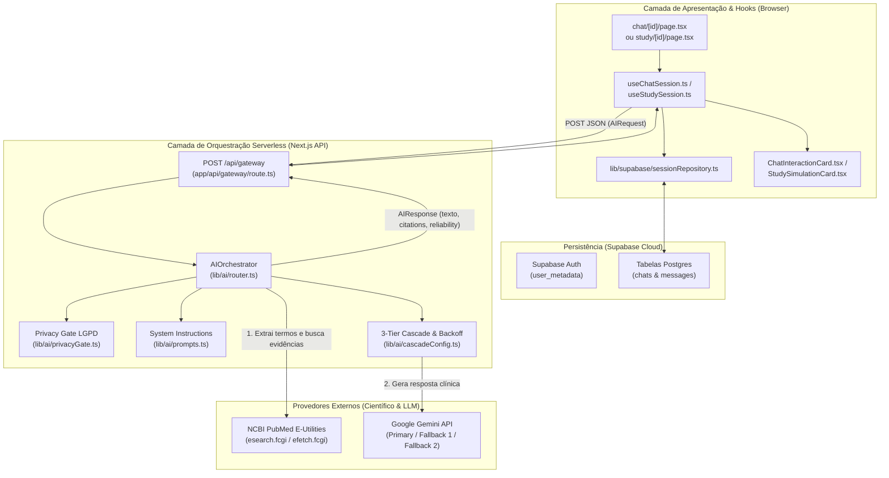
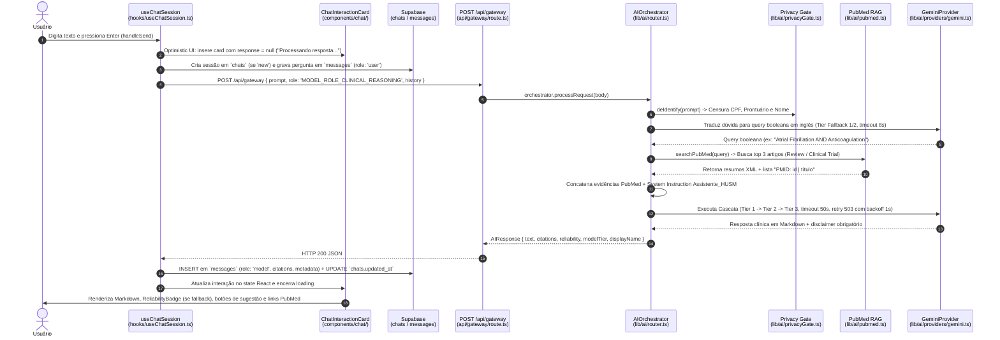

# Arquitetura do Sistema — MedHUSM (`Assistente_HUSM`)

Documento de referência arquitetural para leitura e manutenção humana do projeto **MedHUSM**, uma Progressive Web App (PWA) de suporte ao raciocínio clínico baseado em evidências (RAG PubMed) e simulação educacional para estudantes e profissionais do **Hospital Universitário de Santa Maria (HUSM-UFSM)**.

---

## 1. Stack Tecnológica e Convenções de Código

* **Framework Web & Roteamento:** Next.js 16 (App Router) + React 19 + TypeScript 5.
* **Autenticação & Persistência:** Supabase (`@supabase/ssr`, `@supabase/supabase-js`) — tabelas `chats` e `messages`.
* **Motor de IA & RAG:** Google Gemini (`@google/generative-ai`) em cascata de 3 níveis + API NCBI E-Utilities (PubMed).
* **Estilização:** Neumorphic Design System baseado em Design Tokens CSS (`src/app/design-tokens.css` e `src/app/globals.css`) e CSS Modules.

### Convenções de Nomenclatura e Organização
1. **`src/app/` (Rotas Next.js App Router):** Utiliza estritamente as convenções de arquivos reservados do Next.js (`layout.tsx`, `page.tsx`, `route.ts`), agrupando rotas autenticadas sob o Route Group `(app)`.
2. **`src/components/` (Componentes React em `PascalCase.tsx`):**
   * `ui/`: Primitivos atômicos do Design System Neumórfico (`Button.tsx`, `Card.tsx`, `Input.tsx`).
   * `layout/`: Shell da aplicação, barras de navegação e provedores globais (`TopBar.tsx`, `BottomNav.tsx`, `Providers.tsx`).
   * `common/`: Componentes compartilhados entre múltiplos módulos (`AppInfoModal.tsx`, `EditableSessionHeader.tsx`, `RetryActionButton.tsx`, `SessionHistoryList.tsx`).
   * `chat/`: Componentes específicos do Assistente de Raciocínio Clínico (`ChatInteractionCard.tsx`, `ChatCitationList.tsx`, `ReliabilityBadge.tsx`).
   * `study/`: Componentes específicos do Simulador de Casos Clínicos (`StudySimulationCard.tsx`, `StudyTopicSelector.tsx`, `MultipleChoiceQuestion.tsx`).
3. **`src/hooks/` (Custom Hooks em `camelCase` com prefixo `use`):** Encapsulam o estado da interface e o ciclo de vida das sessões (`useChatSession.ts`, `useStudySession.ts`).
4. **`src/lib/` (Regras de Negócio, IA, Repositórios e Utilitários em `camelCase.ts`):** Módulos puros de domínio, orquestração de IA, integração com PubMed e persistência no Supabase.

---

## 2. Mapa Visual da Estrutura de Diretórios

```text
src/
├── app/                                      # Camada de Roteamento (Next.js App Router)
│   ├── (app)/                                # Grupo de rotas protegidas (exige usuário autenticado)
│   │   ├── chat/
│   │   │   ├── [id]/page.tsx                 # Tela de consulta ativa do Chat Clínico (/chat/[id] ou /chat/new)
│   │   │   └── page.tsx                      # Hub de Histórico Clínico (/chat)
│   │   ├── study/
│   │   │   ├── [id]/page.tsx                 # Tela ativa do Simulador de Casos Clínicos (/study/[id])
│   │   │   └── page.tsx                      # Hub de Sessões de Estudo (/study)
│   │   ├── tools/
│   │   │   ├── cha2ds2-vasc/page.tsx         # Calculadora determinística CHA₂DS₂-VASc (Zero-LLM)
│   │   │   └── page.tsx                      # Menu de Ferramentas Médicas (/tools)
│   │   └── layout.tsx                        # Shell autenticado (TopBar + área de conteúdo + BottomNav)
│   ├── api/
│   │   └── gateway/route.ts                  # Endpoint POST /api/gateway (entrada única para IA)
│   ├── design-tokens.css                     # Tokens atômicos e semânticos de cores, tipografia e sombras
│   ├── globals.css                           # Estilos globais, classes neumórficas (.neu-*) e reset
│   ├── layout.tsx                            # Root Layout (Fontes IBM Plex, PWA manifest, Clarity e Providers)
│   └── page.tsx                              # Tela de Login/Cadastro e aceite das Diretrizes Éticas (Onboarding)
│
├── components/                               # Camada de Apresentação (React Components)
│   ├── chat/
│   │   ├── ChatCitationList.tsx              # Pílulas clicáveis de artigos científicos do PubMed (PMID)
│   │   ├── ChatInteractionCard.tsx           # Card pergunta + resposta Markdown + sugestões + retry
│   │   └── ReliabilityBadge.tsx              # Selo de transparência exibido apenas em respostas de Fallback
│   ├── common/
│   │   ├── AppInfoModal.module.css           # Estilos modulares neumórficos do modal institucional
│   │   ├── AppInfoModal.tsx                  # Modal institucional ("Sobre o MedHUSM", ética e cascata IA)
│   │   ├── EditableSessionHeader.tsx         # Barra de título editável inline para Chat e Estudo
│   │   ├── RetryActionButton.tsx             # Botão compartilhado "Tentar novamente" para falhas de IA
│   │   └── SessionHistoryList.tsx            # Lista reutilizável de sessões salvas no Supabase
│   ├── layout/
│   │   ├── BottomNav.tsx                     # Navegação inferior com retomada de sessão via sessionStorage
│   │   ├── Providers.tsx                     # Wrapper client-side do AuthProvider
│   │   └── TopBar.tsx                        # Barra superior com botão Voltar, modal Info e menu do usuário
│   ├── study/
│   │   ├── MultipleChoiceQuestion.module.css # Estilos neumórficos das alternativas de múltipla escolha
│   │   ├── MultipleChoiceQuestion.tsx        # Componente interativo de questão MCQ (A, B, C, D)
│   │   ├── StudySimulationCard.tsx           # Card de etapa do caso clínico simulado + card de loading
│   │   └── StudyTopicSelector.tsx            # Seletor de especialidade médica ou tema livre de estudo
│   └── ui/
│       ├── Button.tsx                        # Botão neumórfico reutilizável ('default' | 'primary')
│       ├── Card.tsx                          # Superfície neumórfica ('out' extrudado | 'in' baixo-relevo)
│       ├── Input.tsx                         # Campo de texto neumórfico (padrão ou 'pill')
│       └── ui.module.css                     # Estilos base dos componentes primitivos
│
├── hooks/                                    # Camada de Estado e Coordenação de UI
│   ├── useChatSession.ts                     # Ciclo de vida do Chat Clínico (Optimistic UI, DB, Gateway)
│   └── useStudySession.ts                    # Ciclo de vida do Simulador de Estudos (MCQ JSON, DB, Gateway)
│
└── lib/                                      # Camada de Domínio, IA e Infraestrutura
    ├── ai/
    │   ├── providers/
    │   │   └── gemini.ts                     # Integração direta com o SDK @google/generative-ai
    │   ├── analytics.ts                      # Telemetria estruturada de falhas e fallbacks da cascata
    │   ├── cascadeConfig.ts                  # Definição dos 3 Tiers (Primary, Fallback 1, Fallback 2) e timeouts
    │   ├── privacyGate.ts                    # Anonimização LGPD (censura de CPF, Prontuário e Nomes)
    │   ├── prompts.ts                        # System Instructions, persona clínica HUSM e disclaimer obrigatório
    │   ├── pubmed.ts                         # Busca RAG em tempo real no NCBI PubMed (esearch + efetch XML)
    │   ├── router.ts                         # AIOrchestrator (Privacy Gate -> PubMed RAG -> 3-Tier Cascade)
    │   └── types.ts                          # Interfaces AIRequest, AIResponse, ModelRole e AIProvider
    ├── constants/
    │   └── session.ts                        # Chaves de sessionStorage, títulos padrão e constantes de sessão
    ├── supabase/
    │   ├── client.ts                         # Fábrica do cliente Supabase Browser (@supabase/ssr)
    │   └── sessionRepository.ts              # Operações compartilhadas de banco e mapeamento de histórico
    ├── utils/
    │   └── formatters.ts                     # Formatação de datas pt-BR e detecção de erros passíveis de retry
    └── auth.tsx                              # Contexto React de autenticação e controle de onboarding
```

---

## 3. Fluxo Principal de Dados (Interação End-to-End com o Agente de IA)

### 3.1 Arquitetura em Camadas



### 3.2 Sequência Passo a Passo (Do `Enter` do Usuário até a Resposta na Tela)



---

## 4. Mapa de Regras de Negócio (Onde Encontrar Cada Regra)

| Regra de Negócio / Comportamento | Arquivo Responsável | Funções / Constantes Chave |
| :--- | :--- | :--- |
| **1. Anonimização e Conformidade LGPD**<br/>Censura automática de CPFs (`000.000.000-00`), prontuários hospitalares (`00000/0`) e nomes de pacientes antes de enviar a provedores externos. | `src/lib/ai/privacyGate.ts` | `deIdentify()`, `BRAZILIAN_CPF_PATTERN`, `HOSPITAL_RECORD_NUMBER_PATTERN` |
| **2. Persona Clínica, Segurança e Disclaimer Obrigatório**<br/>Tom impessoal sem emojis, início direto sem autodescrição, proibição de diagnóstico definitivo, alerta de emergência e rodapé legal obrigatório. | `src/lib/ai/prompts.ts` | `buildAssistenteHusmSystemInstruction()`, `MANDATORY_CLINICAL_DISCLAIMER` |
| **3. Busca Científica RAG no PubMed**<br/>Conversão da pergunta em query booleana em inglês (usando modelos de alta cota com timeout de 8s) e busca dos 3 artigos mais relevantes (`Review` ou `Clinical Trial`) via NCBI E-Utilities. | `src/lib/ai/router.ts`<br/>`src/lib/ai/pubmed.ts` | `AIOrchestrator.retrievePubMedContext()`, `searchPubMed()`, `fetchPubMedArticleIdentifiers()` |
| **4. Cascata de Resiliência em 3 Níveis (3-Tier Cascade)**<br/>Prioriza `gemini-3.8-flash` (`primary`, 50s), caindo para `gemini-3.5-flash-lite` (`fallback_1`, 50s) e `gemini-3-flash-preview` (`fallback_2`, 50s). | `src/lib/ai/cascadeConfig.ts`<br/>`src/lib/ai/router.ts` | `CASCADE_CONFIG`, `getModelIdForTier()`, `AIOrchestrator.processRequest()` |
| **5. Backoff de Sobrecarga (HTTP 503) e Telemetria**<br/>Até 2 tentativas por tier; aplica pausa de `1000ms` quando ocorre erro 5XX/503 e registra eventos estruturados de fallback no console. | `src/lib/ai/router.ts`<br/>`src/lib/ai/analytics.ts` | `executeSingleTierAttempts()`, `classifyFailureReason()`, `logFallbackEvent()` |
| **6. Visibilidade do Selo de Confiabilidade (`ReliabilityBadge`)**<br/>Oculta qualquer badge quando a resposta provém do modelo primário (`high`); exibe pílula informativa apenas para `fallback_1` e `fallback_2`. | `src/components/chat/ReliabilityBadge.tsx` | `ReliabilityBadge()` |
| **7. Extração de Sugestões de Pesquisa Contínua**<br/>A IA gera links no padrão `[Tema](#sugestao-Tema)`. O frontend extrai esses links via Regex, limpa o texto principal e os transforma em botões que disparam uma nova consulta. | `src/lib/ai/prompts.ts`<br/>`src/components/chat/ChatInteractionCard.tsx` | `extractSuggestionsAndMainContent()`, `SuggestionsListSection()` |
| **8. Formatação de Fontes Científicas (Pílulas PubMed)**<br/>Transforma strings `"PMID: 123456 | Título"` em links externos para `https://pubmed.ncbi.nlm.nih.gov/{pmid}/` com título truncado em 20 caracteres. | `src/components/chat/ChatCitationList.tsx` | `parseCitationEntry()`, `truncateCitationTitle()` |
| **9. Detecção de Indisponibilidade e Retentativa (`Retry`)**<br/>Identifica mensagens de erro/indisponibilidade, exibe o botão *"Tentar novamente"*, limpa os registros com falha no Supabase e reenvia o prompt. | `src/lib/utils/formatters.ts`<br/>`src/hooks/useChatSession.ts`<br/>`src/hooks/useStudySession.ts` | `isRetryableResponse()`, `ASSISTANT_UNAVAILABLE_MESSAGE`, `handleRetryInteraction()` |
| **10. Simulador de Casos Clínicos (Modo Estudo)**<br/>Gera casos clínicos interativos e avalia respostas em formato JSON estrito (`{ content, isMCQ, options }`) com questões de múltipla escolha. | `src/lib/ai/prompts.ts`<br/>`src/hooks/useStudySession.ts`<br/>`src/components/study/MultipleChoiceQuestion.tsx` | `buildInitialCaseSystemInstruction()`, `buildAnswerEvaluationSystemInstruction()`, `requestAndPersistStudyStep()` |
| **11. Calculadora Determinística CHA₂DS₂-VASc (Zero-LLM)**<br/>Cálculo 100% local e determinístico de risco tromboembólico em fibrilação atrial sem chamadas de IA. | `src/app/(app)/tools/cha2ds2-vasc/page.tsx` | `CRITERIA_DEFINITIONS`, `getClinicalRiskRecommendation()`, `handleCalculateScore()` |
| **12. Onboarding Ético Obrigatório e Retomada de Abas**<br/>Exige aceite dos termos éticos no primeiro acesso (`hasCompletedOnboarding`) e preserva a sessão ativa ao alternar entre as abas inferiores via `sessionStorage`. | `src/lib/auth.tsx`<br/>`src/app/page.tsx`<br/>`src/components/layout/BottomNav.tsx` | `completeOnboarding()`, `OnboardingTermsView()`, `resolveTabDestinationPath()` |
